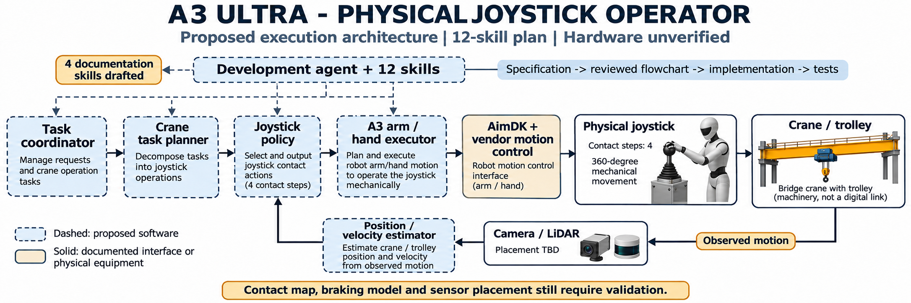
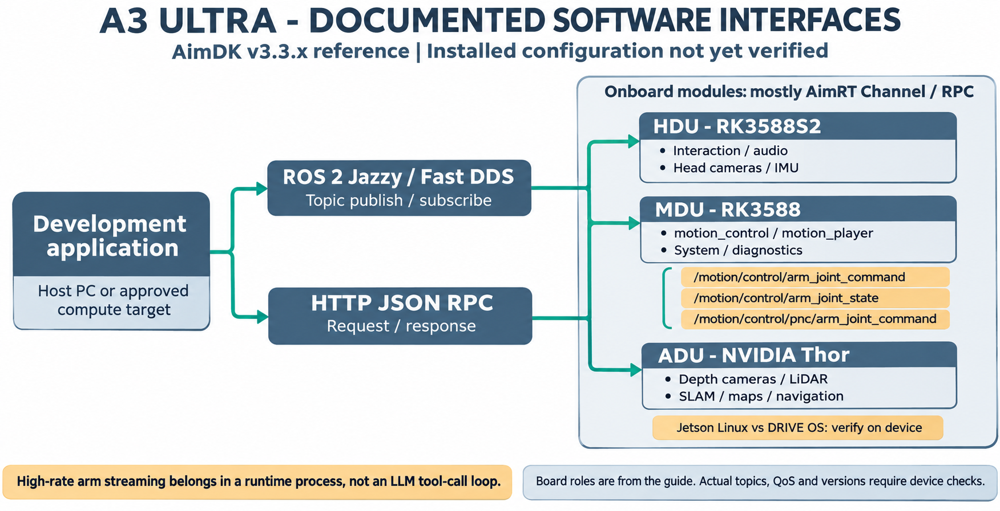
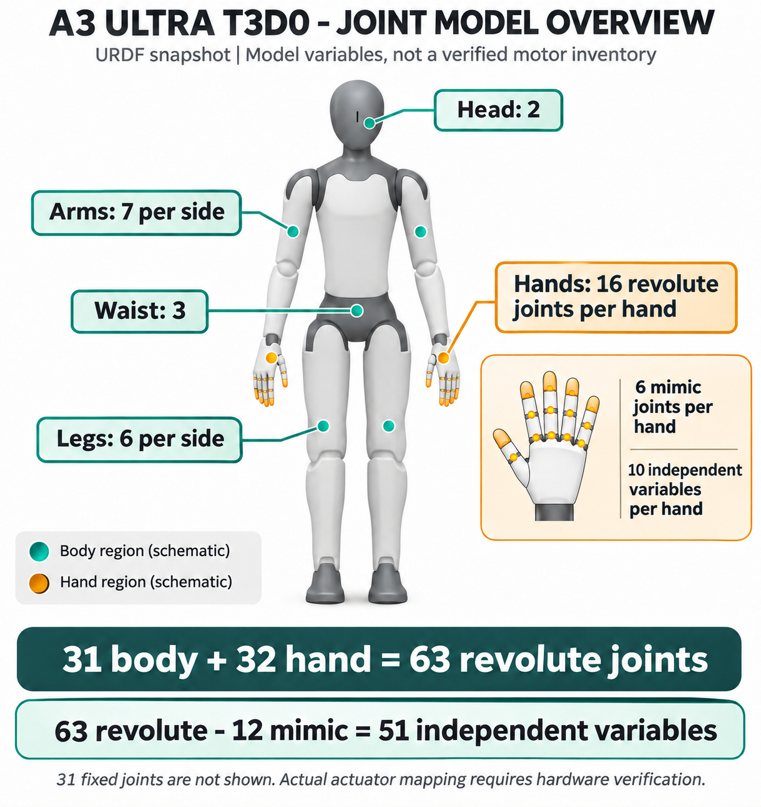

# AgiBot A3 Ultra Skills

A3 Ultra 개발과 크레인 조이스틱 운전 에이전트를 위한 스킬 설계 저장소다. **전체 12개 구성을 합의했고, 현재 문서 탐색용 스킬 4개를 검토용 초안으로 작성했다.** 실제 로봇이나 크레인을 제어하는 프로그램은 아직 포함하지 않는다.

이 README는 **공식 문서에서 확인한 구조**, **사용자와 합의한 목표**, **구현을 검토할 제안**을 구분한다. 그림은 `imagegen`으로 만든 설명용 도해이며, 정확한 식별자와 관절 수는 링크된 원문 및 추출 자료를 기준으로 한다.

## 목차

- [시작하기](#시작하기)
- [합의한 12개 구성](#합의한-12개-구성)
- [스킬 트리맵](#스킬-트리맵)
- [개발 아키텍처](#개발-아키텍처)
- [ROS 2와 보드 구조](#ros-2와-보드-구조)
- [제어 수준](#제어-수준)
- [관절 구조](#관절-구조)
- [7번 설계에서 합의한 조건](#7번-설계에서-합의한-조건)
- [NVIDIA 보조 스킬 후보](#nvidia-보조-스킬-후보)
- [저장소 트리](#저장소-트리)
- [로컬 검색](#로컬-검색)
- [색인 갱신과 검증](#색인-갱신과-검증)

## 시작하기

- [통합 HTML 목차](index.html): 저장소를 내려받은 뒤 브라우저로 열면 검색과 원문 링크를 사용할 수 있다. GitHub 파일 화면에서는 HTML 소스로 표시된다.
- [공통 문서/API 색인](catalog.json): 공식 영문 AimDK A3 Ultra v3_3 가이드의 실제 H1/H2/H3 주소와 인터페이스 기록.
- [문서 불일치와 적용 범위](references/guide-notes.md)
- [검증 기록](validation/REPORT.md)

현재 색인에는 공식 문서 20페이지, 실제 헤더 주소 173개, 표 기반 인터페이스 출현 항목 121개가 있다. 같은 인터페이스가 여러 절에 등장할 수 있어 고유 API 개수와 다르다. 실제 장비 조회는 수행하지 않았다.

## 합의한 12개 구성

기존 논의의 번호를 유지하기 위해 문서 탐색 역할을 2-A부터 2-D로 구분한다.

| 번호 | 스킬 | 역할 | 상태 |
| --- | --- | --- | --- |
| 1 | A3 작업 총괄 | 작업 분해, 스킬 선택, 진행과 중단/재개 관리 | 설계 예정 |
| 2-A | [초보자 가이드](skills/a3-getting-started/SKILL.md) | 보드, 개발 환경, ROS 2/RPC와 첫 개발 안내 | 초안 작성 |
| 2-B | [인터페이스 가이드](skills/a3-interface-guide/SKILL.md) | API 호출 조건, 메시지, 단위, 제어권과 결과 확인 | 초안 작성 |
| 2-C | [하드웨어 가이드](skills/a3-hardware-guide/SKILL.md) | 보드, 전원, 포트, 센서, 보정과 로봇 모델 조사 | 초안 작성 |
| 2-D | [ROS Topic/API 찾기](skills/a3-ros-interface-finder/SKILL.md) | 정확한 식별자, 타입, 예제와 원문 절 탐색 | 초안 작성 |
| 3 | 보드 진단과 복구 | Thor, HDU, MDU의 로그, 프로세스, 통신과 자원 진단 | 설계 예정 |
| 4 | A3 동작 제어 | 팔, 손, 머리, 보행 명령과 피드백 확인 | 설계 예정 |
| 5 | 환경 인식과 위치 추정 | 카메라/LiDAR 기반 작업 공간, 크레인/트롤리 위치와 속도 추정 | 요구사항 논의 중 |
| 6 | 크레인 작업 이해와 계획 | 작업 대상, 목적지, 순서, 경로와 완료 조건 판단 | 설계 예정 |
| 7 | 크레인 조이스틱 운전 | A3의 손으로 기존 조종기를 조작하고 실제 움직임으로 결과 확인 | 상세 설계 논의 중 |
| 8 | 기능 개발과 반복 검증 | 기능 명세, 흐름도 승인, 구현과 테스트의 반복 | 설계 예정 |
| 9 | 강화학습과 시뮬레이션 | 관측, 행동, 보상, 모듈/API 조사와 시뮬레이션 평가 | 설계 예정 |

네 초안은 저장소 전체의 공통 파일을 상대 경로로 참조한다. 각 SKILL.md만 따로 복사하는 설치는 지원하지 않는다. 현재 묶음은 전역 스킬로 설치되거나 자동 활성화되지 않았다.

## 스킬 트리맵

아래 트리는 책임의 분류다. 상시 프로세스 12개 또는 모델 12개를 동시에 실행한다는 뜻은 아니다. 이름만 정한 항목의 빈 스킬 파일을 만들어 구현된 것처럼 표시하지 않았다.

```text
A3 Ultra 개발과 크레인 운전 에이전트
├─ 1. 작업 총괄                         [설계 예정]
├─ 지식과 근거
│  ├─ 2-A. 초보자 가이드                [초안 작성]
│  ├─ 2-B. 인터페이스 가이드            [초안 작성]
│  ├─ 2-C. 하드웨어 가이드              [초안 작성]
│  └─ 2-D. ROS Topic/API 찾기           [초안 작성]
├─ 장비와 관측
│  ├─ 3. 보드 진단과 복구               [설계 예정]
│  ├─ 4. A3 동작 제어                   [설계 예정]
│  └─ 5. 환경 인식과 위치 추정          [논의 중]
├─ 크레인 업무
│  ├─ 6. 작업 이해와 계획               [설계 예정]
│  └─ 7. 물리 조이스틱 운전             [상세 논의 중]
└─ 개발과 학습
   ├─ 8. 기능 개발과 반복 검증          [설계 예정]
   └─ 9. 강화학습과 시뮬레이션          [설계 예정]
```

## 개발 아키텍처



**제안 구조:** 개발 에이전트와 스킬은 요구사항 해석, 근거 탐색, 구현과 검증을 지원한다. 상시 실행 프로그램은 관측, 임무 진행, 제어 판단과 로봇 명령 전송을 담당하도록 검토한다. 배포 보드와 프로세스 분할은 아직 정하지 않았다.

그림의 주 경로는 **작업 목표 → 조이스틱 입력 선택 → A3 팔/손 → 기존 조종기 → 크레인**이다. 크레인 제어기에 직접 디지털 명령을 보내는 경로는 현재 선택한 운전 방식이 아니다. 카메라/LiDAR가 관측한 크레인 위치와 속도는 조작 판단으로 되돌아온다. 센서를 외부에 고정할지 A3에 탑재할지는 미정이다.

| 구성 요소 | 입력과 출력 | 완료 판단 또는 미정 사항 |
| --- | --- | --- |
| 문서/API 검색 | 기능 설명 → 원문 절, 타입, 예제와 불일치 | 문서 후보가 실제 장비에 존재하는지는 별도 확인 |
| 임무 조정 | 작업 목표 → 실행 순서와 진행 상태 | 상시 운영 규칙과 복구 권한 미정 |
| 상태 추정 | 영상/점군 → 위치(m), 속도(m/s), 시각, 관측 품질 | 좌표계, 가림, 지연과 오차 평가 필요 |
| 조이스틱 입력 선택 | 목표와 추정 상태 → 방향, 단계, 전환 조건 | 접점표와 제동 응답 확인 전 수치 정책 미정 |
| 팔/손 실행 | 레버 목표 → 관절 명령과 파지/추종 결과 | 역기구학(IK), 궤적과 조작력 검증 필요 |
| 결과 확인 | 관절 피드백과 크레인 관측 → 진행/정지/완료 여부 | 명령 전송, 손의 조작, 크레인의 실제 정지를 분리 |

새 기능 개발은 **명세 → 개발 흐름도 검토와 컨펌 → 구현 → 테스트 → 실패 원인 수정 → 완료 근거 확인** 순서로 진행한다. Ralph-loop는 이 반복을 수행할 개발 방식이며, 실제 장비에서 무제한으로 재시도하는 권한을 뜻하지 않는다. 종료 조건과 재시도 범위는 해당 기능을 설계할 때 함께 정한다.

세부 입력/출력, 상태 경계와 Mermaid 도식은 [아키텍처 상세](references/architecture.md)에 있다.

## ROS 2와 보드 구조



**공식 문서 기준:** 내부 모듈 대부분은 AimRT의 Channel/RPC를 사용하며, 외부 개발 인터페이스로 ROS 2 Topic과 HTTP JSON RPC를 제공한다. 제조사 모듈을 모두 ROS 2 노드라고 가정하지 않는다. 그림의 통신 연결은 개념 관계이며, 하나의 공용 브리지 프로세스가 모든 통신을 처리한다는 뜻도 아니다. [인터페이스 개요](https://open.agibot.com/docs/en/aimdk/a3-ultra/v3_3/dev_guide/03-second_develop_interface_overview#3-secondary-development-interface-overview)

| 보드 | 문서상의 하드웨어 | 주요 역할 |
| --- | --- | --- |
| HDU | RK3588S2 | 상호작용, 오디오, 머리 관련 카메라와 IMU |
| MDU | RK3588 | 운동 제어, motion_player, 시스템 상태와 진단 |
| ADU | NVIDIA Thor | 깊이 카메라/LiDAR, 인식, SLAM, 지도와 내비게이션 |

보드별 실제 모듈명과 출처는 [보드 구성 상세](references/architecture.md#2-제조사-보드와-소프트웨어-구성)에 있다. 공식 문서의 HDU/MDU IP 대응에는 상충하는 표기가 있어 장비 접속 대상으로 바로 사용하지 않는다. ADU의 실제 OS/BSP가 Jetson 계열인지 DRIVE 계열인지도 아직 확인하지 않았다.

| 인터페이스 예시 | 역할 | 원문 |
| --- | --- | --- |
| `/motion/control/arm_joint_command` | 양팔 14개 관절 위치 명령 | [7.1.5](https://open.agibot.com/docs/en/aimdk/a3-ultra/v3_3/dev_guide/07-01-motion_control#715-arm-control-command-and-state-topic-interfaces) |
| `/motion/control/arm_joint_state` | 팔 위치, 속도, 토크 상태 | [7.1.5](https://open.agibot.com/docs/en/aimdk/a3-ultra/v3_3/dev_guide/07-01-motion_control#715-arm-control-command-and-state-topic-interfaces) |
| `/motion/control/pnc/arm_joint_command` | 팔 위치와 Kp/Kd 설정 | [7.1.6](https://open.agibot.com/docs/en/aimdk/a3-ultra/v3_3/dev_guide/07-01-motion_control#716-arm-control-command-configurable-kpkd) |
| `/motion/control/hand_joint_command` | 손 명령. 실제 손 옵션과 배열 정의 확인 필요 | [7.1.10](https://open.agibot.com/docs/en/aimdk/a3-ultra/v3_3/dev_guide/07-01-motion_control#7110-finger-control-command-and-state-topic-interfaces) |
| `/motion/control/locomotion_velocity` | 보행 속도 배율. 입력 −1~1은 m/s가 아님 | [7.1.4](https://open.agibot.com/docs/en/aimdk/a3-ultra/v3_3/dev_guide/07-01-motion_control#714-walking-control-command-topic-interface) |

문서는 ROS 2 Jazzy/Fast DDS와 기본 QoS `keep_last`, 깊이 `10`, `best_effort`를 제시한다. 팔 위치 명령은 **100 Hz 권장, 인접 명령 간격 30 ms 이하**를 요구하므로 해당 스트리밍은 별도 실행 프로그램에서 처리해야 한다. 상시 상태 RPC 폴링은 **0.2 Hz 이하**, 단기간 폴링은 **1 Hz 미만**으로 권고된다. 이 수치들은 서로 다른 인터페이스의 조건이다. [ROS 환경/QoS](https://open.agibot.com/docs/en/aimdk/a3-ultra/v3_3/dev_guide/03-second_develop_interface_overview#32-ros2-topic), [개발 제약](https://open.agibot.com/docs/en/aimdk/a3-ultra/v3_3/dev_guide/04-second_develop_constraints_overview#4-basic-constraints-for-secondary-development)

## 제어 수준

아래 **L0~L5는 프로젝트 설명용 제안**이다. 제조사의 공식 등급, 자율주행 등급, 기능안전 등급 또는 프로세스 개수를 뜻하지 않는다.

| 수준 | 책임 | 예시 |
| --- | --- | --- |
| L5 개발과 추론 | 근거 조사, 명세, 구현과 검증 | 12개 스킬, 개발 흐름도와 Ralph-loop |
| L4 임무 조정 | 작업 순서와 진행 상태 관리 | 작업 선택, 중단/재개, 완료 확인 |
| L3 크레인 관측과 조작 판단 | 실제 운동을 추정하고 입력 선택 | 위치/속도 추정, 접점 단계와 제동 전환 시점 |
| L2 A3 동작 실행 | 레버 목표를 로봇 동작으로 변환 | IK, 궤적, 파지 유지, 주기적 명령 전송 |
| L1 제조사 운동 제어 | 공식 모드와 명령 처리 | MDU의 mc와 공개 AimDK 인터페이스 |
| L0 장치와 기존 보호 기능 | 실제 센서, 구동기, 조종기, 크레인 | 현장 구성과 동작은 별도 검증 |

제조사 운동 제어 Action인 `PASSIVE`, `DAMPING`, `PD_STAND`, `MOTION`은 이 수준과 다른 개념이다. SM의 `Manual`, `Auto`, `Mapping` 같은 시스템 모드도 별도 계층이다. 관절 위치 명령에 `JointState` 타입을 쓰거나 Kp/Kd를 설정할 수 있다는 사실이 자유로운 전신 토크 제어를 뜻하지 않는다. [구분과 공식 근거](references/architecture.md#4-제어-수준과-제조사-모드는-다른-개념이다)

## 관절 구조



**확인 대상은 공개 T3D0 URDF의 고정 커밋이다.** 실제 장비가 이 변형이라는 사실, 모든 모델 관절이 모터라는 사실, API 배열 차원이 같다는 사실은 확인하지 않았다. 그림의 색상은 부위를 구분하며 정확한 회전축 또는 mimic 관절의 위치를 표시하는 지도가 아니다.

| 분류 | 회전 joint | mimic 종속 joint | 비-mimic 회전 변수 |
| --- | ---: | ---: | ---: |
| 허리 | 3 | 0 | 3 |
| 머리 | 2 | 0 | 2 |
| 왼팔 / 오른팔 | 7 / 7 | 0 / 0 | 7 / 7 |
| 왼다리 / 오른다리 | 6 / 6 | 0 / 0 | 6 / 6 |
| 왼손 / 오른손 | 16 / 16 | 6 / 6 | 10 / 10 |
| **합계** | **63** | **12** | **51** |

전체 모델은 **95 links, 94 joints = revolute 63 + fixed 31**이다. mimic은 다른 관절 좌표를 일정 비율과 오프셋으로 따르는 모델 관계이며 별도의 독립 변수를 추가하지 않는다. 따라서 **63 − 12 = 51개의 비-mimic 회전 변수**가 남는다. transmission 정의가 없으므로 이 집계를 실제 모터 재고표로 사용할 수는 없다.

```text
pelvis_link
├─ 허리 yaw → roll → pitch → torso_Link
│  ├─ 머리 yaw → ultra_head_pitch
│  ├─ 왼팔 7 → 왼손 16 회전 joint (6 mimic)
│  └─ 오른팔 7 → 오른손 16 회전 joint (6 mimic)
├─ 왼다리 hip pitch → roll → yaw → knee → ankle pitch → roll
└─ 오른다리 hip pitch → roll → yaw → knee → ankle pitch → roll

양팔 직렬 순서:
shoulder pitch → shoulder roll → shoulder yaw → elbow
→ wrist roll → wrist pitch → wrist yaw
```

고정 센서와 외장을 포함한 **전체 94개 joint tree, 63개 회전 joint의 범위/축/속도/effort 표, 손가락별 mimic 관계**는 [관절 상세 문서](references/joint-model.md)와 [추출 JSON](references/joints.json)에 있다. origin xyz는 m, rpy와 회전 위치는 rad, 회전 속도는 rad/s, 회전 effort는 N m이며 axis는 해당 joint 프레임 기준이다. 이 값은 URDF 선언값으로, 실물 및 API의 허용값과 별도로 대조해야 한다.

모델과 API를 대조하며 확인한 차이도 보존했다.

- 팔의 API 명령 배열은 좌팔 7개 다음 우팔 7개이며, 손목 순서는 roll → pitch → yaw다. URDF 전체 배열을 그대로 보내면 안 된다.
- 목 피치 이름은 API에서 `head_pitch_joint`, 이 URDF에서 `ultra_head_pitch_joint`다. 자동 alias는 미검증이다.
- 손 API의 추상 명령값과 URDF의 rad/mimic 좌표 사이 변환은 미확인이다.
- planning URDF는 손 32개 관절을 fixed로 바꿨고 일부 발목 origin도 원본과 다르다. 손가락 파지 계획에 그대로 사용할 수 있는 모델이 아니다.
- planning SRDF의 링크 참조 중 30회가 해당 planning URDF에 없는 세 이름을 사용한다. 자동 치환이나 MoveIt 실행은 하지 않았다.

근거: [확인한 원본 URDF](https://github.com/AgibotTech/A3-A3U-robot-model/blob/589f508ff357447c610a3f3004419035ddc8f153/a3_ultra_t3d0/urdf/model.urdf), [모델/API 대응과 재현 방법](references/joint-model.md).

## 7번 설계에서 합의한 조건

아래 내용은 사용자 요구와 현장 설명이며 실측으로 검증한 사양이 아니다.

- 최종 목표는 천장 크레인 운전 업무의 대체다.
- A3가 사람이 사용하던 기둥형 Universal Controller의 조이스틱을 손으로 직접 조작한다.
- 조종기는 접점 방식, 총 4단, 360도 조작으로 설명됐다. 방향별 접점표와 단계 수의 세부 의미는 아직 확인하지 않았다.
- 레버를 중립에 놓아도 크레인 또는 트롤리의 잔류 주행이 생겨 반대 방향 입력으로 감속시켜야 한다고 설명됐다. 구동 회로와 제동 특성은 아직 측정하지 않았다.
- 위치/속도 수치 데이터는 제공되지 않는다. 카메라 또는 LiDAR로 위치와 속도를 추정하는 방향이다.
- 첫 검증 환경은 정해진 연구실 한 층이며, 이후 미지 실내 공간 탐색으로 확장하는 목표를 둔다.
- 상시 상태 감시/장애 대응과 자율 임무 수행을 목표로 한다. 스킬 문서와 상시 실행 프로그램은 별도 구성 요소다.

다음 논의 대상은 외부 고정센서와 A3 탑재센서의 사용 범위다. 센서 배치, 조종기 복귀 특성, 단계별 입력과 제동 관계, 허용 오차와 지연, 자동 복구 권한은 아직 정하지 않았다. 기능 개발은 명세와 흐름도를 함께 검토한 뒤 승인된 범위에서 구현/검증을 반복한다.

### 제공된 조종기 그림에서 읽은 것

사용자가 제공한 사진과 도면은 기둥형 본체, 상부 레버, 둥근 손잡이와 하부 플랜지를 보여준다. 도면의 A/D는 TRAVERSING/TRAVELLING 동작 범주이고 B/C/E/F는 BACKWARD/FORWARD/LEFT/RIGHT 방향 표기다. 여섯 개의 독립 제어축을 뜻한다고 해석하지 않는다. 실제 설치 고정 상태와 이 도면의 실물 일치 여부는 미확인이다.

도면에는 전체 높이 800, 본체 높이 600, 상판 위 레버 높이 180 등의 수치가 보이지만 제공된 캡처에는 단위와 상세 회전 중심, 접점표가 없다. 이 수치를 바로 A3의 손 목표 좌표로 쓰지 않는다. 조종기와 로봇의 기준 좌표, 접근 거리, 파지 위치, 조작력과 입력 상태를 실제 대상으로 확인해야 한다.

레버의 물리적 중립, 전기적 무입력, 크레인/트롤리 정지, 하중 흔들림은 각각 다른 관측 대상이다. 현재의 주요 제어 과제는 사용자 설명상 크레인/트롤리의 잔류 주행이며, 하중 흔들림 제어까지 검증됐다는 뜻은 아니다.

## NVIDIA 보조 스킬 후보

NVIDIA Skill Finder로 공식 live catalog를 조회하고 다음 세 스킬의 본문을 확인했다. 아래는 **외부 보조 스킬 후보**이며 합의한 12개 자체 스킬의 개수를 늘리지 않는다. 후보 스킬 설치, OS/BSP 변경과 장비 접속은 수행하지 않았다.

| 우선순위 | 공식 스킬 | 현재 프로젝트와의 연결 | 적용 전 확인 |
| --- | --- | --- | --- |
| 1 | [jetson-diagnostic](https://github.com/NVIDIA/skills/blob/2371df31af392071effa2bd82f39aa98b130e428/skills/jetson-diagnostic/SKILL.md) | Thor를 포함한 Jetson의 모델/L4T, 메모리, GPU, 온도, 프로세스와 서비스 읽기 전용 진단. 3번 보드 진단의 참고 후보 | 실제 ADU가 지원되는 Jetson host 환경인지 확인 |
| 2 | [jetson-quick-start](https://github.com/NVIDIA/skills/blob/2371df31af392071effa2bd82f39aa98b130e428/skills/jetson-quick-start/SKILL.md) | Jetson/IGX BSP 개발환경 준비를 관련 스킬로 연결하는 라우터 | 특정 질문 UI와 보드/BSP 선택 절차를 전제. 공급사 이미지 변경을 자동 승인하지 않음 |
| 3 | [deepstream-dev](https://github.com/NVIDIA/skills/blob/2371df31af392071effa2bd82f39aa98b130e428/skills/deepstream-dev/SKILL.md) | Python pyservicemaker, GStreamer, TensorRT 영상 파이프라인과 진단. 5번 인식 기능의 참고 후보 | 문서의 OS/CUDA/TensorRT 전제와 A3 설치 버전 대조. ROS 2 제어 스킬은 아님 |

“Jetson JDK” 요청은 JetPack SDK로 우선 해석했다. NVIDIA는 [JetPack을 Jetson용 소프트웨어 스택](https://developer.nvidia.com/embedded/jetpack), [DriveOS를 DRIVE AGX용 소프트웨어 스택](https://developer.nvidia.com/drive/faq)으로 설명한다. A3 SONIC 자료의 Drive Thor 표기를 고려하면, 실제 장비를 식별하기 전에 JetPack 설치나 플래싱을 선택할 근거는 부족하다.

첫 유용한 요청은 다음과 같다.

> A3의 Thor 보드가 jetson-diagnostic의 지원 환경인지 먼저 확인하고, 읽기 전용 자료로 OS/BSP, 메모리, GPU 사용, 온도와 서비스 상태를 분석해줘. 확인되지 않은 값은 미확인으로 남겨줘.

<details>
<summary>후보별 설치 명령과 첫 요청 예시 보기 — 설치는 수행하지 않음</summary>

아래는 필요한 스킬을 선택해 설치할 때 사용할 명령이다. 후보 검색만 수행한 현재 상태에서는 실행하지 않았다.

**jetson-diagnostic — 우선 추천**

```bash
npx skills add nvidia/skills --skill jetson-diagnostic --agent codex --global --yes
```

첫 요청: “현재 Thor 보드가 지원되는 Jetson host인지 식별하고, 읽기 전용 진단으로 모델, L4T, GPU, 메모리, 온도와 서비스 상태를 정리해줘.”

**jetson-quick-start — BSP 개발환경이 필요할 때**

```bash
npx skills add nvidia/skills --skill jetson-quick-start --agent codex --global --yes
```

첫 요청: “공급사 이미지와 현재 버전을 확인하고, 기존 BSP workspace 활용 여부와 필요한 개발환경을 정리해줘. 이 스킬이 요구하는 질문 UI의 지원 여부부터 확인해줘.”

**deepstream-dev — 영상 파이프라인 개발이 필요할 때**

```bash
npx skills add nvidia/skills --skill deepstream-dev --agent codex --global --yes
```

첫 요청: “확인된 OS/CUDA/TensorRT 버전에 맞춰 저장된 영상의 객체 검출을 수행하는 최소 파이프라인을 설계해줘. 설치 호환성을 확인하고 ROS 2 연결은 별도 단계로 구분해줘.”

</details>

## 저장소 트리

```text
.
├─ README.md                      # 구성과 개발 방향
├─ index.html                     # 로컬 문서 탐색과 Topic/RPC 검색
├─ catalog.json                   # 원문 헤더와 인터페이스 색인
├─ assets/
│  ├─ architecture.png            # 제안 실행 구조
│  ├─ ros2-topology.png           # 문서 기반 통신 구조
│  ├─ joint-overview.png          # T3D0 관절 변수 설명
│  └─ prompts/                    # 생성/수정 프롬프트
├─ references/
│  ├─ architecture.md             # 구조와 제어 수준 상세
│  ├─ joint-model.md              # 전체 관절 tree와 한계
│  ├─ joints.json                 # 원본 관절 구조 추출
│  ├─ guide-notes.md               # 버전과 문서 불일치
│  ├─ related-links.json          # 확인한 GitHub 파일
│  └─ search-aliases.json          # 검색 동의어
├─ skills/                        # 작성된 스킬 초안 4개
├─ scripts/                       # 색인, 검색, HTML, 관절 추출 도구
├─ tests/                         # 파서와 검색 회귀시험
└─ validation/                    # 수행한 검증과 미확인 범위
```

## 로컬 검색

아래 명령은 이 저장소의 최상위 폴더에서 실행한다. 검색은 로컬 색인만 읽고 로봇에 연결하지 않는다.

```bash
python3 scripts/find_interface.py "팔 상태" --kind topic
python3 scripts/find_interface.py "팔 강성" --kind topic
python3 scripts/find_interface.py "CheckArmCompliance" --json
```

검색 결과는 문서 후보이며 원문의 현재 내용, 해당 버전 SDK 정의, 실제 장비의 설치 상태를 대신하지 않는다. 미발견은 미지원 판정이 아니다. 불일치가 있는 식별자나 URL은 임의로 수정해 실행하지 않는다.

## 색인 갱신과 검증

HTML 열람과 로컬 검색에는 별도 설치가 필요 없다. 공식 문서 색인을 다시 수집하거나 파서 테스트를 실행하려면 Python 3.9 이상, curl, requirements.txt의 패키지가 필요하다.

```bash
python3 -m venv .venv
.venv/bin/python -m pip install -r requirements.txt
.venv/bin/python scripts/build_catalog.py
.venv/bin/python scripts/build_guide.py
.venv/bin/python -m unittest discover -s tests -v
```

스크립트는 공식 문서 메타데이터를 수집한다. 전체 매뉴얼, 실제 장비 로그, 자격 증명은 이 저장소에 저장하지 않는다. 원문 문장이나 코드에만 등장하는 인터페이스는 추가 탐색이 필요하다.

## 출처

- [A3 Ultra v3.3 공식 개발 가이드](https://open.agibot.com/docs/en/aimdk/a3-ultra/v3_3/dev_guide/)
- [확인한 커밋의 관련 GitHub 파일](references/related-links.json)

제조사 문서와 SDK의 권리 및 적용 조건은 각 원 출처를 따른다. 이 저장소의 색인이나 시뮬레이션 자료가 실제 하드웨어의 동작 또는 물리 정확도를 보증하지 않는다.

설명 그림은 내장 `image_gen`으로 생성하고 사람이 읽을 수 있는 표기와 연결을 원문에 대조했다. [생성 프롬프트와 검토 기록](assets/IMAGE_PROVENANCE.md)을 함께 제공한다. 그림의 로봇 외형과 색상 표시는 개략 표현이며 기계 도면이나 보정 자료가 아니다.
