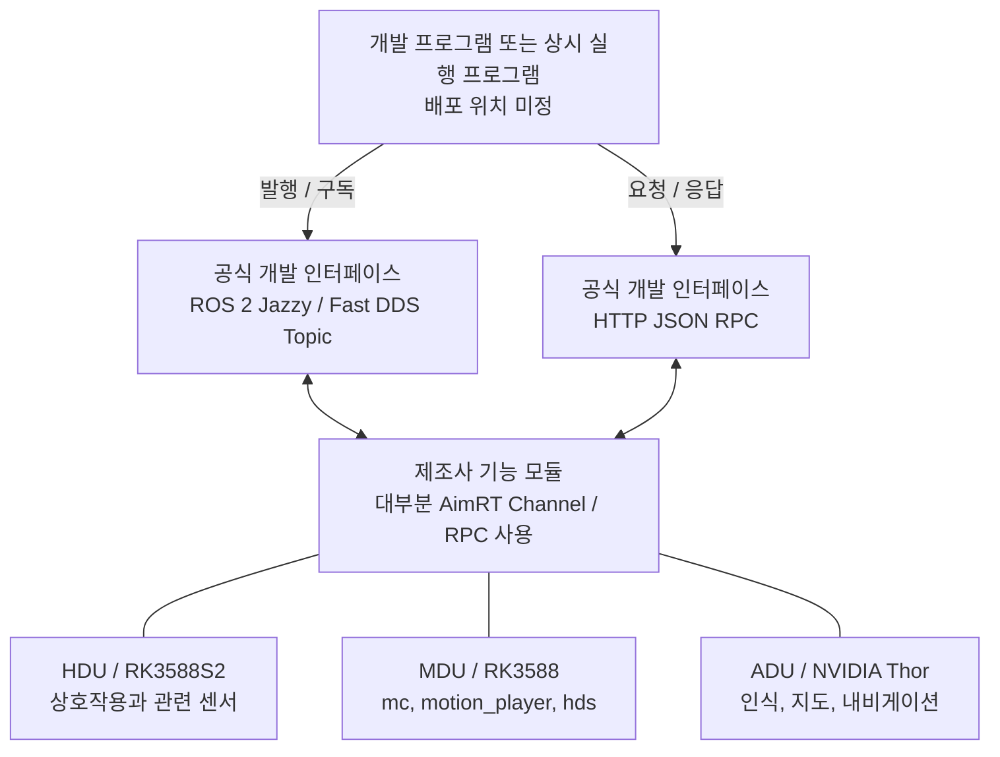
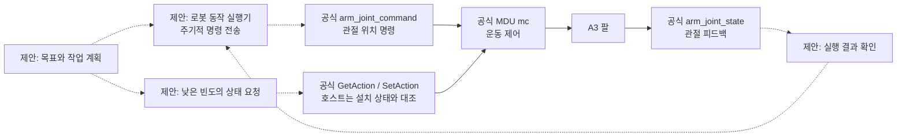
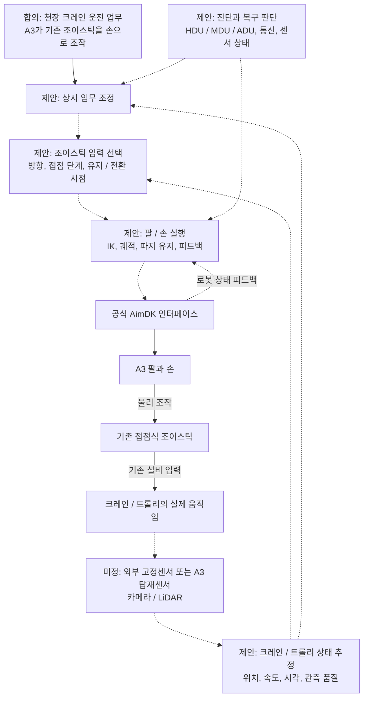
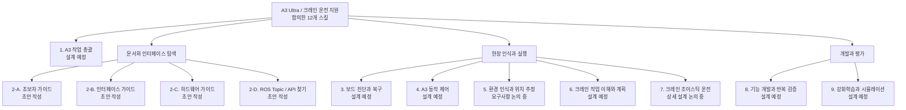
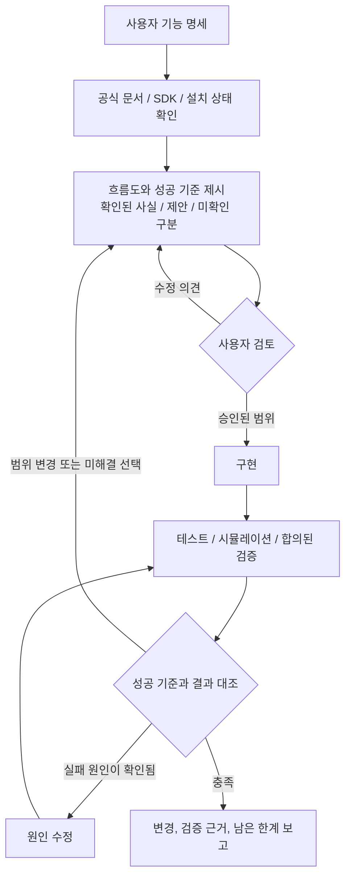

# A3 Ultra 개발 아키텍처와 크레인 운전 구조

이 문서는 **제조사가 문서화한 A3 Ultra 구조**, **사용자와 합의한 목표**, **앞으로 구현을 검토할 모듈**을 구분한다. 12개 스킬 구성은 합의됐지만, 현재 저장소에는 문서 탐색용 스킬 초안 4개와 색인 도구가 있다. 아래 실행 모듈과 배포 구조는 구현 완료 상태가 아니다.

- **✅ 공식 문서:** AimDK A3 Ultra v3.3 가이드에서 확인한 설명이다. 실제 장비 설치 상태를 확인했다는 뜻은 아니다.
- **✅ 합의한 요구사항:** 사용자와 결정한 목표와 작업 범위다.
- **🔶 사용자 설명:** 제공받은 현장 조건이며 실측 사양과 구분한다.
- **🔶 제안:** 역할과 데이터 흐름을 논의하기 위한 설계 후보다. 모듈 분할, 실행 위치, 운영 정책은 아직 확정하지 않았다.
- **❓ 미확인:** 문서 불일치, 설치 환경, 계측값 또는 아직 결정하지 않은 사항이다.

문서 확인 기준일은 2026-11-17이다. 가이드 적용 범위는 A3 Ultra 소프트웨어 3.3.x이며, 링크와 실제 절 주소는 [공통 색인](../catalog.json)을 기준으로 한다. [공식 버전 범위][version]

## 1. 목표와 시험 환경

✅ **최종 목표는 A3 Ultra가 기존 조이스틱을 손으로 조작해 천장 크레인 운전 업무를 수행하는 것이다.** 상시 상태 감시/장애 대응과 자율 임무 수행을 함께 다룬다. 연구실 한 층은 첫 검증 환경이며, 이후 미지 실내 공간 탐색으로 확장하는 목표를 유지한다. [합의한 요구사항](../README.md#7번-설계에서-합의한-조건)

이 목표에서 세 종류의 동작은 따로 확인해야 한다.

| 확인 대상 | 확인하려는 사실 | 다른 결과로 대신할 수 없는 이유 |
| --- | --- | --- |
| A3 팔과 손 | 목표 자세를 추종하고 조종기를 유지하는가 | 관절 명령 전송만으로 실제 파지나 레버 위치를 알 수 없다. |
| 조종기 | 의도한 방향과 단계의 접점 상태를 만들었는가 | 레버의 외형상 위치와 전기적 입력 상태가 같다는 근거가 아직 없다. |
| 크레인/트롤리 | 목표 위치와 속도 상태에 도달했는가 | 중립 입력이나 반대 입력만으로 실제 정지를 판정할 수 없다. |

🔶 사용자 설명상 조종기는 **접점 방식, 총 4단, 360도 조작**이며, 중립 이후 크레인 또는 트롤리의 잔류 주행을 반대 방향 입력으로 감속해야 한다. 현재 사용할 수 있는 크레인 위치/속도 수치 입력이 없어 카메라 또는 LiDAR로 상태를 추정하는 방향이다. 이는 로봇 관절 상태 API가 없다는 뜻이 아니다.

❓ 4단의 방향별 의미, 접점표, 두 축 동시 입력, 자동복귀와 걸림 특성, 입력 지연과 제동 특성은 미확인이다. 따라서 4단을 25/50/75/100% 속도로 환산하거나, 360도 기계 조작을 연속 전기 입력으로 해석하지 않는다. 접점 방식이라는 정보만으로 모터 구동 방식이나 역상제동을 확정할 수도 없다.

## 2. 제조사 보드와 소프트웨어 구성

### 보드별 역할

✅ 공식 가이드는 세 개의 연산 보드를 설명한다. 아래 모듈 배치는 문서상의 배치이며 실제 실행 프로세스 목록이 아니다. [보드 사양][boards], [모듈 배치][modules]

| 보드 | 문서상의 하드웨어와 역할 | 문서에 나오는 주요 모듈 | 이번 프로젝트에서 확인할 대상 |
| --- | --- | --- | --- |
| HDU, Head Domain Unit | RK3588S2, 머리 관련 센서와 상호작용 | `hal_audio`, `hal_hdu_camera`, `hal_imu`, `data_exporter` | 센서 상태, 상호작용, 로그 내보내기, 외부 네트워크 |
| MDU, Motion Domain Unit | RK3588, 로봇 운동 제어 | `SM`, `mc`, `motion_player`, `hds`, `skillpilot`, `tf` | 제어 모드, 관절 피드백, 제어권, 건강 상태 |
| ADU, AGI Domain Unit | NVIDIA Thor, 인식과 지능 연산 | `hal_depth_camera`, `hal_lidar`, `hal_sipl`, `agivslam`, `slam`, `legged_odometry`, `mm`, `pnc` | 센서 데이터, 지도, 위치 추정, 내비게이션 |
| 세 보드 공통 | 프로세스와 공통 서비스 | `PM`, `setting`, `recordbag`, `ota_service` | 프로세스 상태, 설정과 기록의 실제 설치 구성 |

❓ “Jetson Thor”와 “DRIVE Thor”를 현재 장비의 확정 모델명으로 혼용하지 않는다. 공식 개요는 NVIDIA Thor라고 설명하며, [확인한 SONIC 커밋][sonic]은 A3 Ultra용 Drive Thor 실행 경로를 언급한다. 실제 모듈 SKU, OS, 드라이버와 런타임은 장비 증거가 필요하다.

### 프로세스 관리와 통신 프레임워크

✅ 문서는 `systemd`가 시작한 PM(Process Manager)과 SM(State Manager)이 기능 모듈을 관리한다고 설명한다. PM은 프로세스 시작/상태 조회, MDU의 SM은 시스템 모드별 활성 기능을 관리한다. `Manual`, `Auto`, `Mapping` 같은 시스템 모드는 뒤에서 설명하는 운동 제어 Action과 다른 상태 계층이다. [시작 구조][startup], [시스템 모드][system-modes]

✅ 내부 모듈 대부분은 **AimRT**를 사용하며, AimRT의 통신 개념은 **Channel과 RPC(Remote Procedure Call, 원격 함수 호출)**다. 외부 개발에는 **ROS 2 Topic과 HTTP JSON RPC**가 제공된다. 따라서 제조사 모듈 이름을 그대로 ROS 2 노드 이름으로 취급하거나, 모든 내부 연결을 ROS 2 Topic으로 그리면 실제 구조를 왜곡할 수 있다. [통신 구조][interfaces]

이 그림은 인터페이스와 책임의 관계를 표현한다. 하나의 공용 게이트웨이 프로세스나 특정 브리지 노드가 모든 통신을 처리한다는 뜻은 아니다. 서비스별 호스트, 백엔드와 설치 구성은 따로 확인한다.

### 네트워크와 하드웨어 확장 경계

✅ 3.1절은 내부 주소를 HDU `10.42.10.10`, MDU `10.42.10.12`, ADU `10.42.10.11`로 설명한다. 그러나 7장 개요에는 HDU/MDU 대응이 뒤바뀐 표기가 있어 **문서 주소를 실제 연결 대상 확인으로 대신할 수 없다.** [RPC 주소 설명][rpc], [불일치 기록](guide-notes.md#확인된-문서-불일치)

✅ 서비스함 RJ45는 내부 스위치를 통한 Ethernet 연결을 제공한다. 같은 서비스함의 USB Type-A는 디버그 직렬 포트이며 표준 USB 포트가 아니고, USB Type-C는 리모컨 충전 전용이다. 내부 주변장치 포트와 구분해야 한다. 외부 센서를 연결할 때는 전원, 포트 기능, 케이블과 해당 보드의 지원 범위를 확인한다. [서비스함][service-ports], [내부 주변장치 포트][internal-ports]

## 3. ROS 2와 HTTP RPC를 어떻게 나눌 것인가

✅ 문서의 ROS 2 기준은 **Jazzy와 Fast DDS**다. Topic 기본 QoS(Quality of Service, 전달 정책)는 `keep_last`, 깊이 `10`, `best_effort`로 제시된다. 실제 Topic의 타입과 QoS, 발견 설정은 해당 장비와 대조해야 한다. [ROS 2 환경과 QoS][ros-topic]

| 통신 | 문서상의 용도 | 프로젝트에서의 사용 후보 | 확인할 점 |
| --- | --- | --- | --- |
| ROS 2 Topic | 빈번한 데이터 전송, 여러 송수신자 | 관절 상태 구독, 연속 관절 명령, 센서 데이터 수신 | 타입, 단위, 순서, QoS, 타임스탬프, 누락과 지연 |
| HTTP JSON RPC | 낮은 빈도의 요청/응답 | 상태 조회, 모드 전환 요청, 작업 관리 | 대상 보드/포트, 호출 조건, 비동기 완료 확인 |
| AimRT 내부 Channel/RPC | 제조사 모듈 사이의 통신 | 필요한 경우 SDK와 설정을 읽어 실제 경로 조사 | ROS 2에 노출된다고 가정하지 않기 |

✅ 4절의 권장 RPC 폴링 빈도는 **상시 상태 조회 0.2 Hz 이하**, **단기간 상태 조회 1 Hz 미만**이다. 전자는 요청 사이 최소 5초에 해당한다. 이 수치를 Topic 제어 주기에 적용하거나 상시 감시를 빠른 RPC 반복 호출로 구현하지 않는다. [개발 제약][constraints]

### 정확한 인터페이스 예시

다음은 문서에서 찾은 6개 예시다. 실행 명령이나 완성된 제어 프로그램이 아니며, 이름만 복사해 호출할 수 있다는 의미도 아니다. Topic에 특정 RPC IP를 붙여 배포 위치를 추정하지 않는다.

| 공식 식별자 | 통신과 타입 | 쓰임과 제어 범위 | 원문 |
| --- | --- | --- | --- |
| `pb:/aimdk.protocol.MotionControlActionService/SetAction` | HTTP JSON RPC, 문서 호스트 `10.42.10.12` | 운동 제어 Action 변경 요청. 요청 수락과 전환 완료는 다르다. | [7.1.2][motion-action] |
| `pb:/aimdk.protocol.MotionControlActionService/GetAction` | HTTP JSON RPC, 문서 호스트 `10.42.10.12` | 현재 운동 제어 Action 조회 | [7.1.2][motion-action] |
| `/motion/control/arm_joint_command` | ROS 2 Topic, `sensor_msgs::msg::JointState` | 정해진 순서의 14개 팔 관절 위치 명령 | [7.1.5][arm] |
| `/motion/control/arm_joint_state` | ROS 2 Topic, `sensor_msgs::msg::JointState` | 팔 관절 위치, 속도, 토크 피드백 | [7.1.5][arm] |
| `/motion/control/pnc/arm_joint_command` | ROS 2 Topic, `joint_msgs/msg/JointCommand` | 관절 위치와 Kp/Kd 설정이 가능한 팔 명령 | [7.1.6][arm-pd] |
| `/motion/control/locomotion_velocity` | ROS 2 Topic, `ros2_plugin_proto/msg/RosMsgWrapper` | 보행 방향별 속도 배율 명령. 입력은 −1~1의 무차원 값이며 m/s가 아니다. | [7.1.4][walk] |

✅ 팔 위치 명령 문서는 **100 Hz 권장**, **인접 명령 간격 30 ms 이하**, **관절 속도 4 rad/s 이하**를 제시한다. 이는 해당 인터페이스의 조건이지, 카메라나 크레인 정책을 모두 100 Hz로 실행하라는 뜻은 아니다. [팔 명령 조건][arm]

🔶 따라서 대규모 언어 모델(LLM)의 추론과 도구 호출은 목표, 개발, 진단과 작업 조정을 맡고, 주기적인 명령 전송은 별도 실행 프로그램이 맡는 구성을 제안한다. 실행 주기를 보장할 런타임, 통신 지연 측정 방법, 입력이 오래됐을 때의 처리는 아직 설계/검증 대상이다.

실선은 문서화된 인터페이스의 기능 관계이고, 점선은 프로젝트가 추가할 연결의 제안이다. 팔 피드백만으로 크레인의 이동 결과를 검증할 수 없으므로, 크레인 관측 경로는 별도로 필요하다.

## 4. 제어 수준과 제조사 모드는 다른 개념이다

### 프로젝트 설명용 제어 수준

🔶 아래 L0~L5는 **책임을 설명하기 위해 제안한 프로젝트 내부 구분**이다. 제조사 공식 분류, 자율주행 등급, 기능안전 등급 또는 실시간 성능 보증을 뜻하지 않는다. 표의 위아래 관계가 새로운 배포 계층이나 여섯 개 프로세스 생성을 요구하지도 않는다.

| 수준 | 책임 | 구현 상태와 경계 |
| --- | --- | --- |
| L5 개발과 추론 | 문서/SDK 조사, 명세와 흐름도, 코드 구현, 시험 결과 해석 | 12개 스킬이 지원할 영역. 사용자와 합의한 개발 범위에서 진행 |
| L4 임무 조정 | 작업 선택, 순서, 진행 상태, 중단/재개 관리 | 상시 실행 목표에 따른 제안. 자동 복구 권한과 운영 규칙은 미정 |
| L3 크레인 상태 추정과 조작 판단 | 영상/점군에서 위치와 속도를 추정하고 조이스틱 방향, 단계와 타이밍을 선택 | 핵심 개발 대상. 상태 추정기와 정책 방식은 미정 |
| L2 A3 동작 실행 | 레버 목표를 팔/손 움직임으로 변환하고 주기적으로 실행 | 역기구학(IK), 궤적, 파지와 결과 확인 모듈은 제안 단계 |
| L1 제조사 운동 제어 | 로봇의 운동 제어 Action과 관절 명령 처리 | 공식 `mc` 및 관련 모듈. 공개된 API 범위와 제어권 조건을 따름 |
| L0 장치와 기존 보호 기능 | 로봇의 센서/구동기, 제조사 보호 기능, 조종기와 크레인 설비 | 실제 장비 구성과 동작 미검증. 새 소프트웨어가 기존 보호 기능을 대체한다는 주장을 하지 않음 |

L2의 IK는 원하는 손 위치/자세에서 로봇 관절각을 계산하는 기능을 뜻한다. 현재 문서에서 이 프로젝트에 맞는 IK 구현이나 조종기 파지 기능을 확인했다는 뜻은 아니다.

### 공식 운동 제어 Action

✅ `PASSIVE`, `DAMPING`, `PD_STAND`, `MOTION`은 제조사 운동 제어 상태이며, 각각 기본 상태, 감쇠 상태, 위치 제어 기립, 운동 상태로 설명된다. `SIT_DOWN`, `STAND_UP` 등 다른 Action도 있다. 프로젝트 L0~L5나 SM의 시스템 모드와 대응시키지 않는다. [운동 제어 상태][motion-overview]

✅ 팔 명령은 `MOTION` 등의 인터페이스 조건과 기존 `motion_player`의 제어권을 확인해야 한다. 문서가 요구하는 모듈 조정은 별도 상태 변경이며, 이 구조 문서는 해당 변경을 실행하거나 운영 정책으로 확정하지 않는다. [제어권 조건][motion-overview]

✅ 팔 명령에 `JointState` 타입이 사용돼도 자유로운 토크 제어를 뜻하지 않는다. 일반 팔 명령의 `velocity`와 `effort`는 유효하지 않으며, Kp/Kd 설정 명령도 `velocity`와 `effort`는 유효하지 않다고 명시된다. Kp는 관절 강성(단위 `N m/rad`), Kd는 감쇠 계수(단위 `N m s/rad`)다. 위치 명령과 이 계수의 설정을 전신 저수준 토크 제어로 확대 해석하지 않는다. [팔 위치 명령][arm], [Kp/Kd 명령][arm-pd]

## 5. 크레인 운전용 실행 프로그램의 제안 구조

🔶 다음 그림은 합의한 목표를 기능으로 나눈 설계 초안이다. 상시 실행 프로그램의 배포 보드와 프로세스 수, 센서 배치, 제어 정책은 미정이다. **스킬 문서가 상시 실행 프로그램 그 자체는 아니다.**

✅ 그림의 물리 조작 경로는 사용자가 선택한 목표다. 크레인 PLC에 직접 명령을 보내는 경로는 현재 합의된 실행 방식이 아니다. 🔶 점선 모듈은 모두 구현을 검토할 대상이며, 점선 화살표는 통신 방식이 확정됐다는 뜻이 아니다.

### 제안 모듈의 입력과 출력

| 제안 모듈 | 입력 | 출력과 검증 대상 | 아직 결정하지 않은 것 |
| --- | --- | --- | --- |
| 크레인 상태 추정 | 카메라 영상 또는 LiDAR 점군, 시간/좌표 보정 정보 | 크레인/트롤리 위치(m), 속도(m/s), 관측 시각과 품질 | 센서 위치, 축과 부호, 가림 대응, 허용 오차/지연 |
| 조이스틱 입력 선택 | 목표, 추정 상태, 확인된 접점 모델 | 방향, 단계, 유지 시간 또는 전환 조건 | 접점표, 잔류 주행 모델, 제동 정책, 두 축 동시 조작 |
| 팔/손 실행 | 레버 목표와 실제 로봇 상태 | 팔/손 명령과 실제 추종/파지 상태 | IK/궤적 방식, 파지 형상, 조작력, 단계 검출 |
| 결과 확인 | 로봇 피드백과 독립적인 크레인 관측 | 작업 진행, 도달/정지 여부, 불확실성 | 완료 허용 오차, 관측 지속 시간, 접점 상태 확인 수단 |
| 진단과 복구 판단 | 보드 로그, 프로세스, 통신, 센서와 실행 상태 | 원인 후보, 확인 근거, 복구 제안 또는 허용된 조치 | 자동 복구 권한, 재시도 범위, 복구 후 임무 재개 조건 |

축의 이름과 부호는 현장 접점표와 실제 기계축에 맞춰 정의해야 한다. 카메라의 좌우, 로봇의 좌우, 크레인/트롤리 이동 방향을 같은 좌표계로 취급하지 않는다. 속도 추정에는 영상/점군의 시간 간격과 지연이 영향을 주므로 위치 결과만 저장해서는 제동 판단을 재현하기 어렵다.

❓ 센서 배치는 다음 한 가지 분기로 남겨 둔다. **외부 고정센서, A3 탑재센서, 또는 둘의 조합 중 무엇을 사용할지 미정**이다. A3가 움직이면 탑재센서의 관측 좌표도 바뀌므로 로봇 자세와 외부 기준 좌표 사이의 변환을 함께 다뤄야 한다. 어떤 구성이 현장 가림을 해결한다고 아직 결론 내리지 않는다.

### 중립과 정지를 구분하는 검증 경계

🔶 실행 결과는 다음 세 가지를 분리해 기록하도록 제안한다.

1. 레버가 물리적으로 중앙에 도달했는가.
2. 전기적으로 중립 입력이 되었는가.
3. 크레인/트롤리와 하중이 요구된 정지 상태에 도달했는가.

하중 흔들림과 크레인/트롤리의 잔류 이동도 다른 상태다. 반대 입력이 기존 이동을 줄이는 구간과, 정지 후 반대 방향으로 출발시키는 구간을 구분해야 한다. 현재는 이 전환점을 판정할 모델이나 수치를 확정하지 않았다.

로봇의 `DAMPING`, 로봇의 E-Stop, 조이스틱 중립, 크레인의 정지를 같은 기능으로 취급하지 않는다. 센서 소실이나 로봇 이상 시 조종기를 어떻게 유지/해제하고 크레인을 어떻게 정지시킬지는 기존 설비 동작을 확인한 뒤 별도로 정할 사항이다.

## 6. 12개 스킬의 기능 트리

아래는 **합의한 12개 역할의 트리**다. 동일한 이름의 실행 프로세스나 ROS 2 노드 12개가 있다는 의미는 아니다. 2-A~2-D 네 개만 현재 초안 파일이 있고, 나머지는 역할과 요구사항을 논의하는 단계다.

| 현재 초안 | 공통 자료를 사용하는 방식 |
| --- | --- |
| [2-A 초보자 가이드](../skills/a3-getting-started/SKILL.md) | 보드, 개발 환경, 통신과 첫 작업의 맥락 설명 |
| [2-B 인터페이스 가이드](../skills/a3-interface-guide/SKILL.md) | 호출 조건, 단위, 제어권과 완료 확인 절차 해석 |
| [2-C 하드웨어 가이드](../skills/a3-hardware-guide/SKILL.md) | 보드, 센서, 전원, 포트와 보정 자료 탐색 |
| [2-D ROS Topic/API 찾기](../skills/a3-ros-interface-finder/SKILL.md) | 정확한 식별자, 타입, 예제 경로와 원문 절 검색 |

네 초안은 [catalog.json](../catalog.json), [문서 불일치 기록](guide-notes.md), [커밋을 고정한 관련 링크](related-links.json)를 공유한다. 스킬마다 매뉴얼을 중복 복사하는 대신 같은 근거를 찾아 읽는 구조다.

## 7. 기능 개발과 반복 검증 흐름

✅ 합의한 개발 방식은 **명세를 받고 흐름도를 함께 검토한 뒤, 승인된 범위에서 구현과 검증을 반복하는 것**이다. 🔶 다음 흐름은 이를 설명하는 초안이다. Ralph-loop의 도구, 반복 예산, 자동 복구와 실기기 시험의 범위는 아직 정하지 않았다.

중요한 기준은 반복 횟수가 아니라 관측 가능한 결과다. 코드 테스트 통과, 시뮬레이션 추종, 실제 레버 입력, 실제 크레인 정지는 서로 다른 검증 단계이며 앞 단계가 뒤 단계의 성공을 보증하지 않는다.

## 8. 배포, 강화학습과 남은 결정

✅ 공식 4절은 **MDU에 이차 개발 프로그램을 배포하지 말 것**, HDU/MDU 시스템 설정과 온보드 모듈 설정/의존성을 임의 변경하지 말 것을 명시한다. `apt` 설치/제거도 금지한다. 빌드 예제에 MDU 대상이 있다는 이유로 새 실행기를 MDU에 배포해도 된다고 해석하지 않는다. 이 문서의 새 모듈은 ADU, HDU 또는 외부 개발 시스템 중 어디에 배치할지 아직 결정하지 않았다. [제약][constraints], [MDU 관련 문서 불일치](guide-notes.md#확인된-문서-불일치)

🔶 강화학습은 두 문제를 분리해 검토할 수 있다. 하나는 크레인 관측에서 조이스틱의 방향/단계/타이밍을 선택하는 문제이고, 다른 하나는 A3의 팔/손 또는 전신 동작을 만드는 문제다. 어느 부분에 학습을 적용할지 정하지 않았으며, 고수준 AimDK 인터페이스와 전신 제어용 별도 실행 경로를 같은 것으로 취급하지 않는다.

✅ [SONIC의 확인한 커밋][sonic]에는 A3/A3U의 학습, 시뮬레이션과 배포 경로가 설명돼 있다. 이는 관련 구현을 조사할 출처이며, 현재 조이스틱 작업에 적합하다는 검증은 아니다. 상세 가이드는 [같은 커밋의 학습/Sim2Sim/Sim2Deploy 문서][sonic-guide], 모델 출처는 [로봇 모델 안내][robot-model]를 사용한다.

| 후속 결정/검증 | 결정을 바꾸는 근거 |
| --- | --- |
| 실제 A3 하드웨어와 설치 버전 | 보드 식별, 소프트웨어/SDK, 프로세스, Topic과 RPC 정의 |
| 조종기 입력 모델 | 접점표, 복귀/걸림, 축별 단계, 조작력과 실제 출력 |
| 크레인 상태 관측 | 센서 배치, 좌표 보정, 시각 동기, 가림, 위치/속도 오차와 지연 |
| 제동과 완료 조건 | 잔류 이동과 반대 입력에 대한 실측 응답, 정지/도달 판정 기준 |
| 실행과 복구 권한 | 상시 프로그램의 실행 위치, 허용된 변경, 재시도와 재개 조건 |
| 평가 환경 | 로봇/조종기/크레인 모델의 범위와 실제 실험으로 확인할 차이 |

핵심 원칙은 **명령을 보낸 사실, 로봇이 움직인 사실, 크레인 작업이 완료된 사실을 따로 검증하는 것**이다. 재현을 위해 목표, 관측 시각, 좌표/단위, 입력 단계, 실제 결과를 함께 남기는 방식을 제안한다. 조이스틱 단계나 중립을 물리 속도 또는 정지 상태로 바로 치환하는 것이 가장 먼저 피해야 할 오류다.

변경: 공식 구조, 합의한 목표, 제안 모듈을 구분한 아키텍처 참고 문서를 추가했다.
검증: 공식 문서와 공통 색인의 절/인터페이스, 고정 커밋 링크를 대조했다. 실제 배포와 동작 시험은 안 돌려 봤음.
남은 위험: 설치 구성, 조종기 접점, 센서 배치와 크레인 제동 응답이 아직 미확인이므로 이 문서는 실행 가능한 운전 사양이 아니다.

[version]: https://open.agibot.com/docs/en/aimdk/a3-ultra/v3_3/dev_guide/
[boards]: https://open.agibot.com/docs/en/aimdk/a3-ultra/v3_3/dev_guide/01-a3_overview#16-industrial-pc-specifications
[startup]: https://open.agibot.com/docs/en/aimdk/a3-ultra/v3_3/dev_guide/02-software_overview#21-basic-startup-mode
[modules]: https://open.agibot.com/docs/en/aimdk/a3-ultra/v3_3/dev_guide/02-software_overview#22-module-function-overview
[system-modes]: https://open.agibot.com/docs/en/aimdk/a3-ultra/v3_3/dev_guide/02-software_overview#221-system-modes
[interfaces]: https://open.agibot.com/docs/en/aimdk/a3-ultra/v3_3/dev_guide/03-second_develop_interface_overview#3-secondary-development-interface-overview
[rpc]: https://open.agibot.com/docs/en/aimdk/a3-ultra/v3_3/dev_guide/03-second_develop_interface_overview#31-http-json-rpc
[ros-topic]: https://open.agibot.com/docs/en/aimdk/a3-ultra/v3_3/dev_guide/03-second_develop_interface_overview#32-ros2-topic
[constraints]: https://open.agibot.com/docs/en/aimdk/a3-ultra/v3_3/dev_guide/04-second_develop_constraints_overview#4-basic-constraints-for-secondary-development
[motion-overview]: https://open.agibot.com/docs/en/aimdk/a3-ultra/v3_3/dev_guide/07-01-motion_control#711-overview
[motion-action]: https://open.agibot.com/docs/en/aimdk/a3-ultra/v3_3/dev_guide/07-01-motion_control#712-state-machine-switching-and-query-rpc-interfaces
[walk]: https://open.agibot.com/docs/en/aimdk/a3-ultra/v3_3/dev_guide/07-01-motion_control#714-walking-control-command-topic-interface
[arm]: https://open.agibot.com/docs/en/aimdk/a3-ultra/v3_3/dev_guide/07-01-motion_control#715-arm-control-command-and-state-topic-interfaces
[arm-pd]: https://open.agibot.com/docs/en/aimdk/a3-ultra/v3_3/dev_guide/07-01-motion_control#716-arm-control-command-configurable-kpkd
[service-ports]: https://open.agibot.com/docs/en/aimdk/a3-ultra/v3_3/dev_guide/09-hardware_development_guide#2-service-compartment-interfaces-service-breakout-interfaces
[internal-ports]: https://open.agibot.com/docs/en/aimdk/a3-ultra/v3_3/dev_guide/09-hardware_development_guide#5-other-interfaces-inside-the-chest-compartment
[sonic]: https://github.com/AgibotTech/sonic_for_a3/blob/0311d712e3d6febbafd58dcb8b09417e4b2a3bb1/README.md
[sonic-guide]: https://github.com/AgibotTech/sonic_for_a3/blob/0311d712e3d6febbafd58dcb8b09417e4b2a3bb1/docs/a3_training2sim2deploy.md
[robot-model]: https://github.com/AgibotTech/A3-A3U-robot-model/blob/589f508ff357447c610a3f3004419035ddc8f153/README_EN.md
